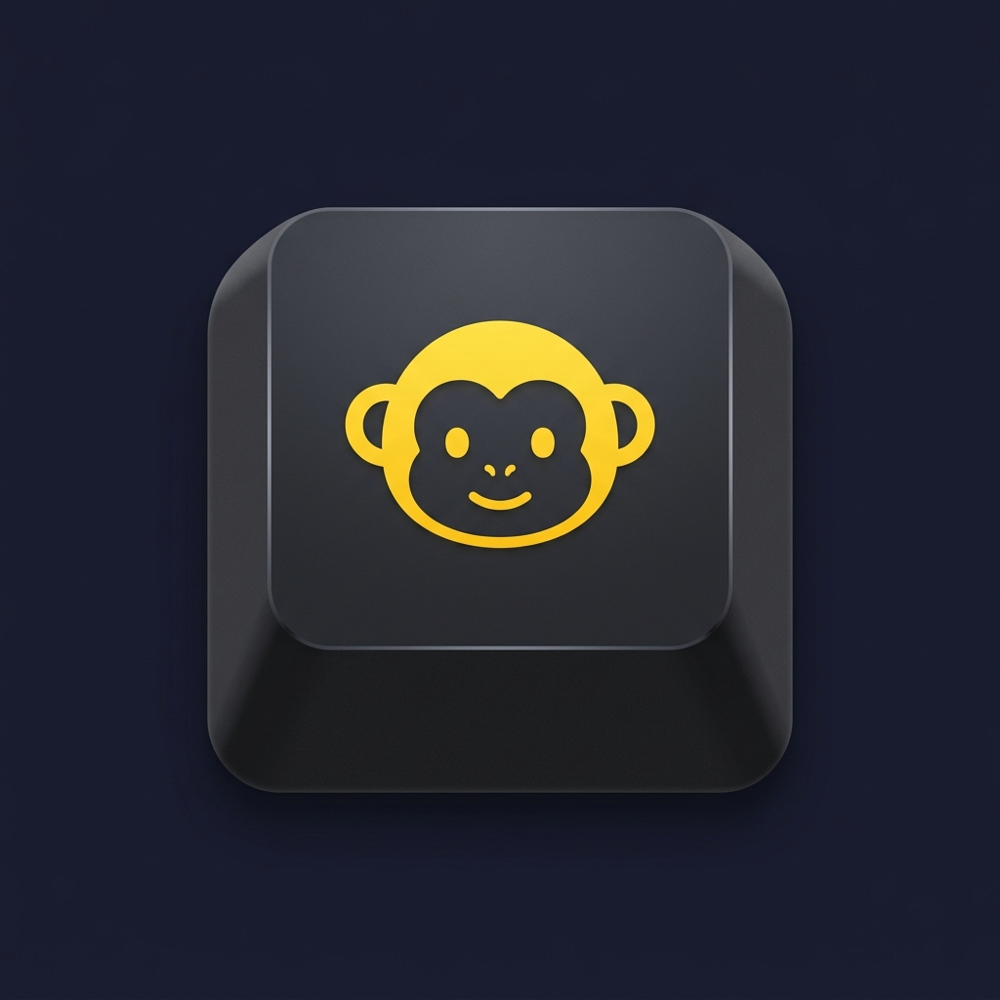

<div align="center">



# MonKeys

**The mechanical keyboard your Mac always wanted.**

Procedurally synthesized key sounds · per-app profiles · typing games · zero telemetry

[](https://github.com/SafetH16/Monkeys/actions/workflows/build.yml)


[](LICENSE)

[Install](#install) · [Features](#features) · [Privacy & security](#privacy--security) · [Build from source](#build-from-source) · [Changelog](CHANGELOG.md)

</div>

---

**MonKeys** is a macOS menu bar utility that turns any keyboard into a virtual mechanical keyboard. Every keypress produces a **procedurally synthesized** switch sound with per-key stereo positioning, natural per-press variation and a distinct acoustic character for space, enter, modifiers and more. It ships a full preset editor, per-app sound rules with automatic meeting muting, two arcade-quality typing games, a local statistics dashboard and an on-screen keyboard visualizer — all in a single, dependency-free app.

> **Privacy first.** MonKeys never records, stores or transmits what you type. Key events trigger local sounds and visuals, then they are discarded. Statistics are aggregate counters that never leave your Mac. The only network access is the update check against GitHub Releases — no analytics, no telemetry.

## Features

| | |
|---|---|
| 🔊 **Procedural sound engine** | 18 built-in switch voices (Clicky Blue, Tactile Brown, Linear Red, Deep Thock, Silent Office, Terminal…), 16-voice polyphony, stereo panning by physical key position, ±2% pitch / ±5% gain natural variation |
| 🎛 **Preset editor** | 8 synthesis parameters with live preview, user presets, validated JSON import/export |
| 🪟 **Per-app profiles** | One rule per app: mute, force a voice, custom volume — applied the instant you switch apps |
| 🎧 **Device awareness** | Knows where the sound is going: per-output rules (mute on speakers, full volume in headphones), current output shown in the menu, engine survives device switches |
| 🤫 **Meeting mode** | Auto-mutes when Zoom, Teams, FaceTime & co. come to the front (configurable whitelist) |
| 🧘 **Focus & Game modes** | One-click quiet profile at low volume, or boosted WASD/Space for gaming |
| 📚 **Student tools** | 25+5 study sessions with chimes, import your vocabulary as a typing exercise, daily typing goal |
| 🎮 **Typing games** | *Save the Bananas* (waves, boss bananas, weekly duel, unlockable palettes) and *Speed Challenge* (5 difficulties + weak-key drill, ghost curve, flow tiers with dynamic music) |
| 🏅 **Progression** | Medals per mode, daily missions, play streak — and a monkey typing rank from *Capuchin* to *Silverback* |
| 📊 **Statistics** | Today/all-time counters, peak WPM, keyboard heatmap, top keys — aggregate-only, clearable |
| ⌨️ **Visualizer** | Floating panel that lights up keys as you type |
| 🌍 **9 languages** | English, Italiano, Español, Français, Deutsch, Português, 日本語, 中文, 한국어 |

## Install

1. **[Download the latest MonKeys.zip](https://github.com/SafetH16/Monkeys/releases/latest/download/MonKeys.zip)**
2. Unzip and move **`MonKeys.app`** into **Applications**.
3. MonKeys is currently **not code-signed or notarized**, so Gatekeeper warns on first launch. Clear the quarantine flag once:
   ```bash
   xattr -cr /Applications/MonKeys.app
   ```
4. Launch the app and grant the **Accessibility** permission when prompted (see below).

### Permissions

MonKeys uses a global `CGEvent` tap to detect key presses system-wide, which requires the **Accessibility** permission (System Settings → Privacy & Security → Accessibility). An onboarding window guides you through it on first launch and closes automatically once granted.

That is the *only* permission MonKeys needs — no microphone, no screen recording, no camera. If macOS temporarily disables the event tap under heavy load, MonKeys re-enables it automatically.

> **Note for source builds:** the app is ad-hoc signed, so every reinstall changes its code signature and macOS silently invalidates the previous Accessibility grant. Remove MonKeys from the Accessibility list (−) and add it again (+), or run `tccutil reset Accessibility com.safethalipaj.MonkeysApp`.

## The menu

A compact, native menu — rebuilt live on every open:

- **Status header** — what is playing and why (*Active · Tactile Brown*, *Muted · meeting (Zoom)*, *Focus · volume 30%*…), plus live WPM and today's key count.
- **Sounds** — master toggle with its global shortcut (default **⌃⇧K**, re-mappable) and a volume slider with live percentage.
- **Preset** — all built-in and user voices, with an audible preview.
- **Current app** — a contextual submenu named after the frontmost app (with its icon): mute it in one click or create/edit its rule.
- **Modes** — Focus, Game, Mute in meetings.
- **Games** — both games, game music, today's mission and play streak.
- **Statistics…**, **Settings…** (⌘,), **Quit**.

## Sound engine

All built-in sounds are **synthesized at runtime** — no third-party audio recordings are distributed. Space, Enter, Backspace, modifiers, navigation, function and numpad keys each have their own acoustic character; every press gets subtle pitch/gain variation and stereo placement matching the key's physical position. Buffers are cached per key after first synthesis, keeping the event-tap path allocation-free and low-latency.

In **Settings → Sound** you can edit 8 synthesis parameters (loudness, pitch, click character, thock depth, resonance, hold, release, variation) with live preview, save user presets (built-ins are never modified) and export/import presets as JSON. Imports are strictly validated — 256 KB limit, schema check, numeric clamping, collision auto-rename — a malformed file cannot crash the app.

## App profiles & meeting mode

**Settings → App Profiles** defines one rule per application: enable/disable sounds, force a voice, set a volume, or mute entirely while that app is frontmost.

**Meeting mode** is intentionally best-effort: it reacts to the frontmost app matching a configurable whitelist (Zoom, Teams, FaceTime, Skype, Slack, Webex, Discord by default). MonKeys does **not** access your microphone, screen or other apps' content, so it cannot know with certainty that a call is active.

**Device rules** (Settings → Devices) add one more layer: mute or set a volume per output category — built-in speakers, Bluetooth headphones, USB & other. Typing sounds through MacBook speakers in an office and through your AirPods are different experiences; MonKeys treats them differently. The menu always shows the current output under the volume slider.

Priority, highest first: manual mute → manual unmute override (holds until you switch apps) → meeting mode → app rule → device rule → global settings.

## Games

- 🍌 **Save the Bananas** — catch falling letters before they reach the ground. 40-second waves with scorecards, golden bananas, bombs, ice, word bananas, **boss bananas**, Fever ×2, a deterministic **weekly duel** with a shareable score, and four unlockable color palettes. Zen mode (**Z**) removes lives for younger players.
- ⌨️ **Speed Challenge** — five difficulties plus a **weak-key drill** built from your own heatmap, 3-2-1 countdown, live WPM/accuracy/combo, flow tiers that drive the music intensity, a **ghost curve** of your best run, and word banks in 6 languages.

Both games feed a light progression layer: per-mode **medals**, one deterministic **daily mission**, a **play streak**, and an all-time **typing rank** (Capuchin → Gibbon → Macaque → Mandrill → Gorilla → Silverback) shown in the statistics dashboard. Everything lives in local `UserDefaults` — no accounts, no leaderboard servers.

## Statistics

The dashboard (menu → Statistics…) shows today's key count, the all-time total, peak WPM, your monkey rank with progress to the next one, a keyboard heatmap and your top 5 keys.

- Counters are **aggregate only**: no text, no key sequences, no per-event timestamps, no app targets.
- Stored locally in the app sandbox, never transmitted.
- Disable or **Clear Local Statistics** anytime in Settings → Privacy.

## Privacy & security

- **No keylogging.** Key codes are used transiently for sound/visual dispatch and aggregate counters (opt-out), never stored as sequences or content.
- **No dependencies.** No third-party code, package managers or external scripts at build time.
- **Sandboxed.** App Sandbox with the single user-selected-file entitlement needed for preset import/export.
- **Safe updates.** The updater downloads exclusively from this repository's GitHub Releases over HTTPS and swaps the bundle only after verifying the archive, keeping a backup for rollback.
- **No secrets.** The repository and the shipped binary contain no credentials.

## Build from source

No Xcode project needed — the entire app compiles with `swiftc`:

```bash
./build.sh          # → build/MonKeys.app (arm64, macOS 13+, Swift 6 strict concurrency)
open build/MonKeys.app
```

CI compiles every push and pull request on `macos-15` with read-only permissions and no secrets.

### Source layout

| Area | Files |
|---|---|
| App & menu | `main.swift`, `AppDelegate.swift` |
| Input | `KeyboardMonitor.swift` (CGEvent tap), `WPMTracker.swift` |
| Audio | `SoundEngine.swift`, `SoundSynthesizer.swift`, `KeySoundProfile.swift` |
| Presets | `SoundProfileStore.swift`, `SettingsStore.swift` |
| Rules | `AppProfileManager.swift` |
| UI | `SettingsWindow.swift`, `StatsWindow.swift`, `VisualizerWindow.swift`, `OnboardingWindow.swift` |
| Games | `GameView.swift`, `SpeedTypeView.swift`, `GameProgress.swift` |
| Misc | `TypingStats.swift`, `Updater.swift`, `Localization.swift` |

## Troubleshooting

| Problem | Fix |
|---|---|
| No sounds at all | Check the Accessibility permission (see the note about reinstalls above); check the master toggle, the volume, and that no Focus/meeting auto-mute is active — the menu header always shows the reason |
| "App is damaged / can't be opened" | `xattr -cr /Applications/MonKeys.app` (unsigned app) |
| Sounds stopped after granting the permission | Quit and relaunch MonKeys once |
| Auto-muted unexpectedly | An app rule or meeting mode matched the frontmost app — see Settings → App Profiles; a manual unmute overrides it until you switch apps |
| Update failed | The updater never deletes the old app before verifying the new one — retry, or download from Releases |

## Roadmap

- **Code signing & notarization** — Developer ID signing with hardened runtime and notarization in `build.sh`/CI as soon as an Apple Developer membership is available; the `xattr` step then disappears. Nothing in the current design blocks this.

## License

[MIT](LICENSE) — no monkeys were harmed in the making of this app. 🐒
